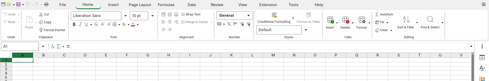
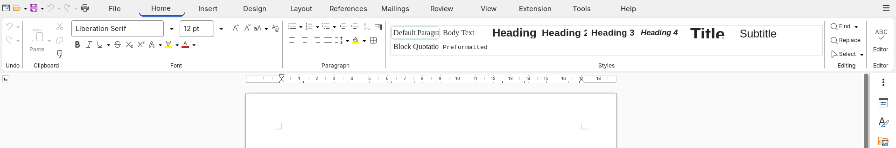
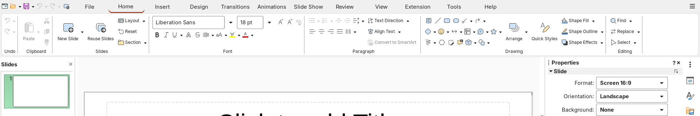
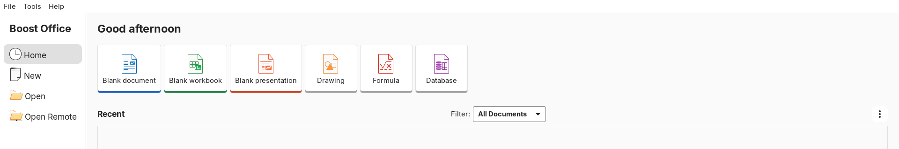

# Boost Office

Boost Office is a fork of LibreOffice that gives Calc, Writer and Impress a Microsoft 365-like ribbon (LibreOffice's
"Tabbed Office" interface, rebuilt tab by tab), Fluent-based icons, light and dark color schemes and the Inter UI
font. It targets Linux desktops (GTK 3). Download a release archive, or build it from this repository, then install
it for your user with one script.

> **Notice.** Boost Office is not affiliated with or endorsed by The Document Foundation or Microsoft. LibreOffice
> is a trademark of The Document Foundation. Microsoft 365, Word, Excel and PowerPoint are trademarks of Microsoft.
> They are named here only to say which ribbon layout Boost Office follows.

## Download

Boost Office 0.1.2 is the current preview: a built Linux x86_64 tree, no build needed. Install it for your user, without
root, with one command:

```sh
curl -fsSL https://github.com/nahuel893/boost-office/releases/latest/download/boost-office-install.sh | bash
```

It downloads the release archive, checks its sha256, and adds `boost-writer`, `boost-calc`, `boost-impress` and
`boost-office` and their desktop entries. Add `-s -- --theme dark` after `bash` for the dark look; run it again to
upgrade; `-s -- --uninstall` removes it. It needs glibc 2.44 or newer (Arch Linux, Manjaro and other rolling
distributions; the script refuses an older system before downloading), GTK 3 and `python3`. A build for Ubuntu, Debian
and Fedora is planned. The release notes on <https://github.com/nahuel893/boost-office/releases/latest> list the
tested distributions, and [product/docs/install.md](product/docs/install.md) has the options and the manual (offline)
install from the archive.









## Status

All three apps are built. An install carries the Boost brand: the splash, the About dialog's logo and the product name
("Boost Office" in window titles, dialogs and Tools > Options), applied by the installer with no rebuild (the dev
profile carries the name too). Strings compiled into the program (the About dialog's copyright line, the window
class `libreoffice-*`) keep the build's LibreOffice(Dev) name.

| App | Ribbon | Placeholders (greyed) | Design record |
|---|---|---|---|
| Calc | Excel-like: File, Home, Insert, Page Layout, Formulas, Data, Review, View, Help (plus LibreOffice's Extension and Tools) | 65 buttons and menu items | [calc-ribbon-tabs.md](product/docs/calc-ribbon-tabs.md) |
| Writer | Word-like: File, Home, Insert, Design, Layout, References, Mailings, Review, View, Help (plus Extension and Tools) | 42 buttons | [writer-ribbon-tabs.md](product/docs/writer-ribbon-tabs.md) |
| Impress | PowerPoint-like: File, Home, Insert, Design, Transitions, Animations, Slide Show, Review, View, Help (plus Extension and Tools) | 26 buttons | [impress-ribbon-tabs.md](product/docs/impress-ribbon-tabs.md) |

- **A greyed button is a placeholder.** Microsoft's ribbon has it, LibreOffice has no such feature yet. It shows the
  tooltip "<Label> (not available yet)" and does nothing. The design records list every one.
- **Menu bar.** LibreOffice features without a Microsoft button leave the ribbon and stay in the menu bar.
- **English only.** The new labels and tooltips are not translated.
- **Linux only.** No Windows or macOS build, and no distribution packages.

## Install

With the one-command installer: see [Download](#download). From your own build (`instdir`):

```sh
product/install/install.sh              # light theme, into ~/.local/opt/boost-office, no root
product/install/install.sh --theme dark
```

It adds the launchers `boost-office`, `boost-writer`, `boost-calc` and `boost-impress` and desktop entries, and keeps
its own profile in `~/.config/boost-office`. Every option, the uninstall and troubleshooting are in
[product/docs/install.md](product/docs/install.md).

## Build

[product/docs/building.md](product/docs/building.md): packages, the configure flags
(`product/install/autogen.input.boost`), `product/dev/lo-make.sh`, and the disk and memory a build takes. A full
LibreOffice build is long; plan for a first build that runs unattended.

## Develop

| Where | What |
|---|---|
| [product/README.md](product/README.md) | Index of everything Boost adds to LibreOffice |
| `product/dev/` | Dev launchers, `shot-tab.sh` (screenshots), `uitest.sh` (UI tests), `lo-make.sh` (memory-capped build) |
| `product/tests/` | Unit tests: `python3 -I -m unittest discover -s product/tests -t .` |
| `product/docs/`, `product/odd/tasks/` | Design records and feature plans |
| [CONTRIBUTING.md](CONTRIBUTING.md) | How to propose a change |

## Branches

| Branch | Use |
|---|---|
| `main` | Default branch: the state of the last closed feature |
| `dev` | Integration branch: it moves to the same commit when a feature closes |
| `feature/*` | One feature each, until it closes |

## Licences

Boost's own files are under the [MPL 2.0](COPYING.MPL), as most of LibreOffice; inherited code keeps its licences
([COPYING](COPYING) and [COPYING.LGPL](COPYING.LGPL) hold the other texts). The bundled fonts and icons have their
own: see [product/docs/licenses.md](product/docs/licenses.md).

LibreOffice's own README is [README-LibreOffice.md](README-LibreOffice.md).
