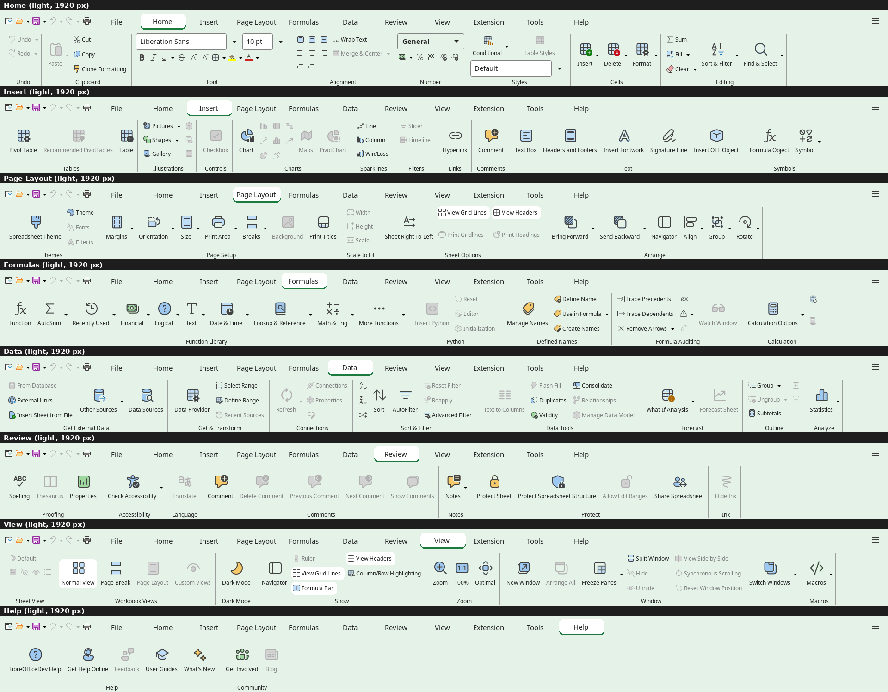
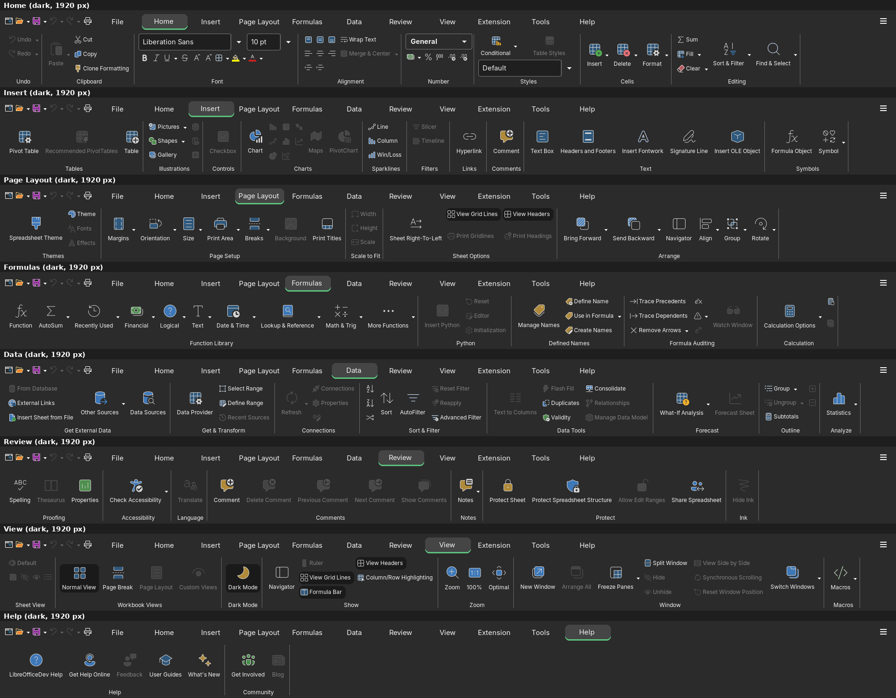
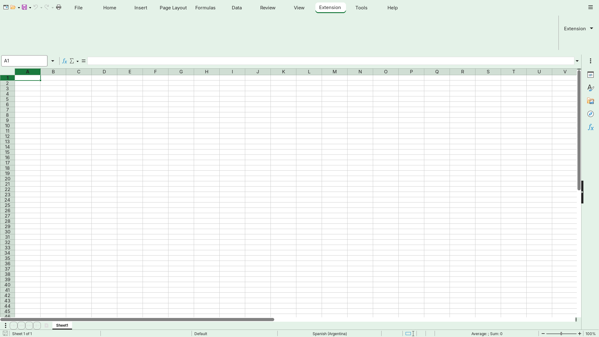
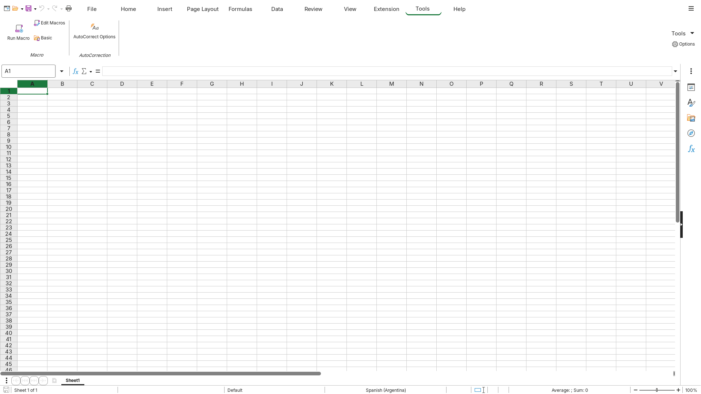
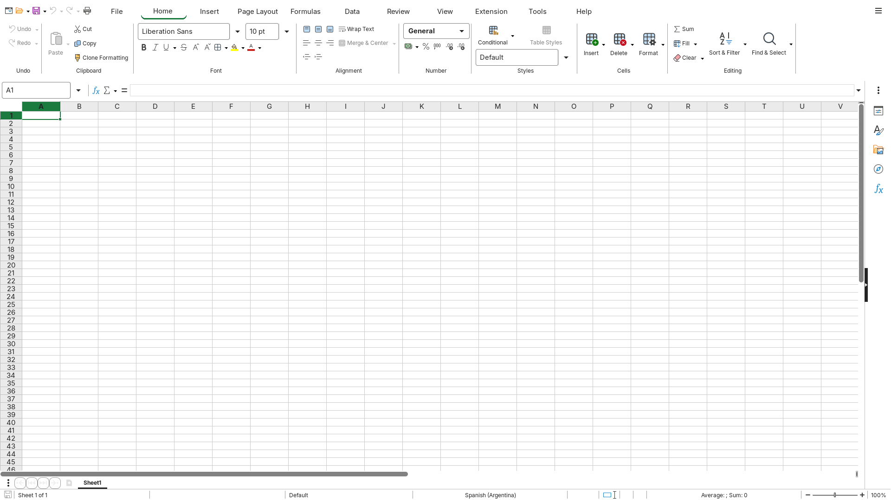
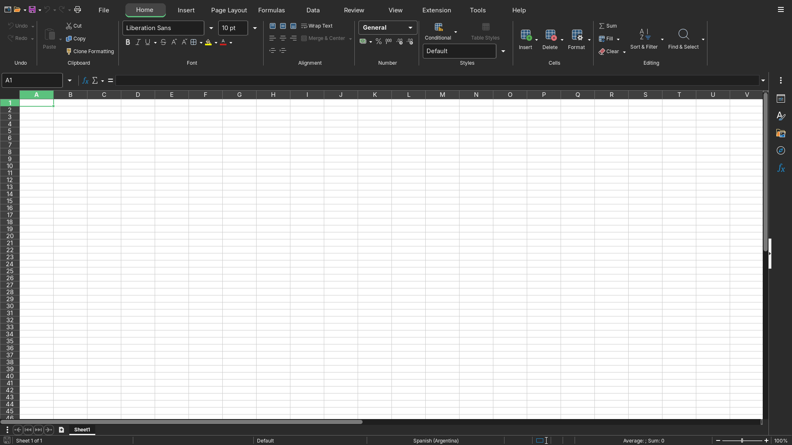
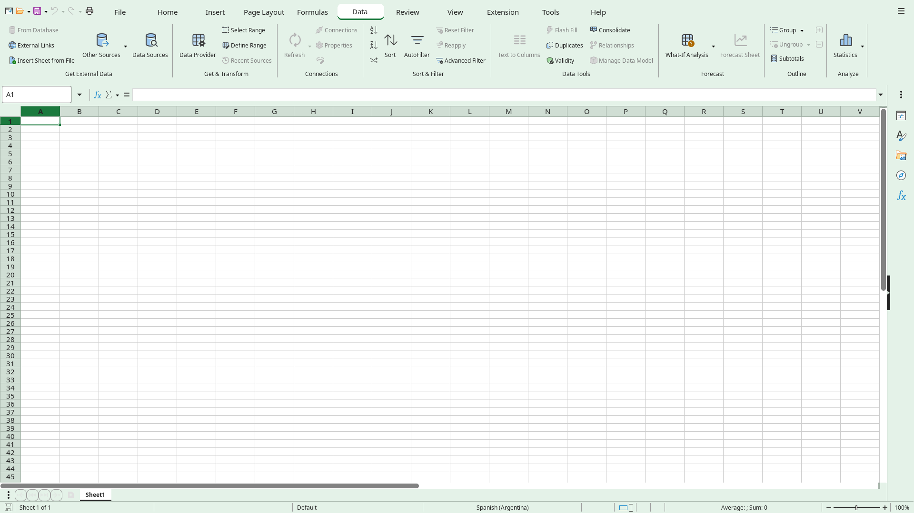
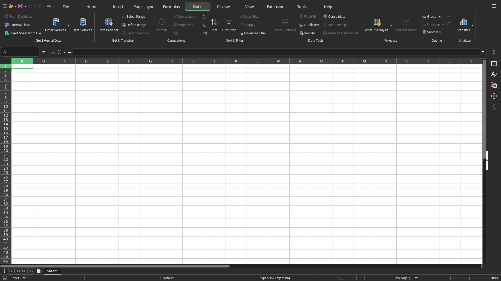

# Screenshots

## The three apps (used by the root README)

Home tab, light theme, 1920 px wide, cropped to the top band: quick access bar, tabs, ribbon and a little of the
document. The ribbon is a rounded card on the light gray window color, as Microsoft 365 draws it. Retaken on
2026-10-26 with `product/dev/shot-tab.sh --app <app> light Home`. The UI font is Inter.

## The Start Center (used by the root README)

What `boost-office` opens with no document: light theme, 1920 px wide, cropped to the same top band (navigation,
greeting, the new-document tiles and the Recent heading). Taken on 2026-10-25 with
`product/dev/shot-tab.sh --app start light - <out> 1920`.

## Calc, earlier screenshots

Calc in Tabbed Office mode at 1920 px, taken on this build on 2026-10-20.
The UI font is Inter.

Greyed buttons are placeholders: features to build later. The full list is in
[calc-ribbon-tabs.md](../calc-ribbon-tabs.md) and
[calc-data-redesign.md](../calc-data-redesign.md).

## Every tab

The ribbon of each tab, stacked top to bottom: Home, Insert, Page Layout,
Formulas, Data, Review, View and Help.

## Extension and Tools

These two tabs come from LibreOffice and keep their content; only their captions
were aligned with the other tabs.

## Home and Data, full window

